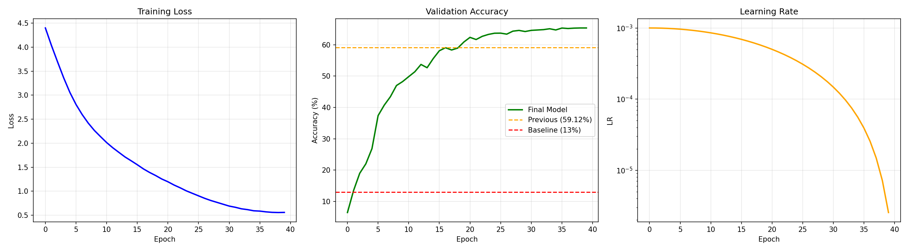
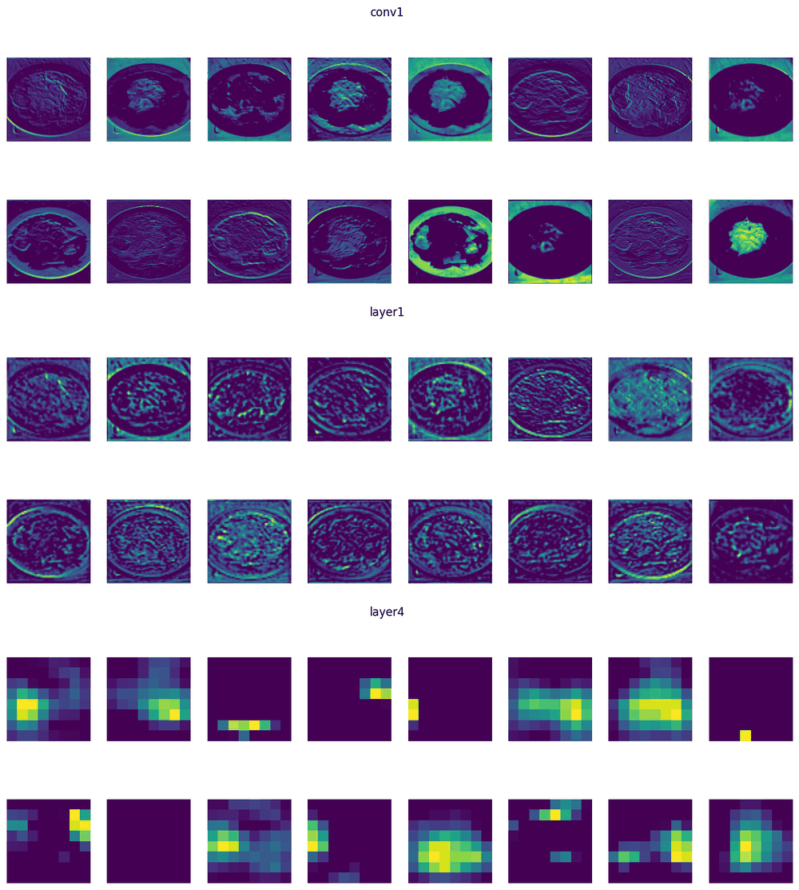

# Deep Learning: Food-101 Image Classification With ResNet And CNN Layers From Scratch


Convolutional-network building blocks implemented from scratch, and a ResNet-style classifier trained on [Food-101](https://data.vision.ee.ethz.ch/cvl/datasets_extra/food-101/) (101 food classes, 101,000 images). Deep Learning module, MSc Computing (Artificial Intelligence & Machine Learning), Imperial College London, 2026.

## Overview

The project has two parts:

1. **Layers from scratch** – `Conv2d` (unfold + matrix multiplication), `MaxPool2d`, `Linear` and `BatchNorm2d` (batch statistics when training, running statistics when evaluating), written with basic tensor operations.
2. **Food-101 classification** – a baseline ResNet-style network is improved into a ResNet-18-style model with data augmentation, AdamW, cosine learning-rate annealing, dropout, early stopping and resumable checkpoints. The model is then analysed on the official test split, on out-of-distribution images and through its feature maps.

## Results

| Model | Parameters | Test accuracy | Hot dog class |
|---|---|---|---|
| Baseline ResNet-style network (10 epochs) | 11.2M | 13.59% | 10.8% |
| **Improved ResNet-18-style model (40 epochs)** | 11.2M | **70.96%** | 69.2% |

- Test set: the official 25,250 images. Best validation accuracy: 65.33%. Food-101's training split deliberately contains some noisy labels while its test split is clean, which likely explains why validation accuracy is lower than test accuracy.
- **Robustness to distribution shift:** on 1,000 stylised hot-dog images (different texture, colour and style from the training data) accuracy falls to 52.7%.

### Training



Loss, validation accuracy (against the baseline and an earlier run) and the cosine learning-rate schedule over 40 epochs.

### What the network learns



Feature maps for one test image. Early layers (`conv1`, `layer1`) respond to edges, plate outlines and textures; the last residual stage (`layer4`) is coarse and sparse, activating on the discriminative region of the dish.

## Training setup

224×224 crops from images resized to 256; random resized crop, horizontal flip, rotation, colour jitter and translation as augmentation; AdamW (learning rate 1e-3, weight decay 1e-3); cosine annealing to 1e-6 over 40 epochs; batch size 128; dropout 0.5 before the classifier; early stopping with patience 10; 10% of the training images held out for validation (seed 90).

## Repository structure

```
├── dl_cw_1.ipynb        # layers, baseline, improved model, evaluation and visualisation
├── requirements.txt
└── results/             # figures used in this README
```

## Getting started

```bash
pip install -r requirements.txt
jupyter notebook dl_cw_1.ipynb
```

- Python 3.10+; a GPU is strongly recommended.
- The notebook downloads Food-101 (about 5 GB) on first run and writes the model weights (`baseline_model.pt`, `best_model_final.pt`), `checkpoint.pt` and `history.json`. Weights are not stored in the repository because of their size.
- The out-of-distribution section clones the public helper repository [`bkainz/icl_dl_cw2_utils`](https://github.com/bkainz/icl_dl_cw2_utils), which provides the hot-dog image dataset.

## Reference

L. Bossard, M. Guillaumin and L. Van Gool, *Food-101 – Mining Discriminative Components with Random Forests*, ECCV 2014.
